# 数据库设计（PostgreSQL）

本文件提供完整需求的表结构说明；原设计已确认，2026-09-08 补充门店优惠券张数额度与 Go 后端任务结构，可执行 SQL 迁移尚未生成。表中的“预留”指不开发该功能的其他端 API；第一版仍创建这些表和关联。跨模块表可同时支撑网页查询与未来端写入。

## 1. 全局约定

- 主键统一 `id uuid`；所有表有 `created_at timestamptz`，可变实体另有 `updated_at timestamptz`。业务时间以带时区时间存储，日期/月度统计按 Asia/Shanghai 解释。
- 下表 `uuid→表` 表示外键；`?` 表示允许空，未标 `?` 为必填（明确写默认值的字段可在创建时省略）。`UQ` 唯一约束，`CK` 检查约束。关联表也有主键，组合另加 UQ。
- 金额用 `numeric(14,2)`，比例用 `numeric(7,6)`，体测用 `numeric(10,3)`，次数/积分用整数；禁止浮点金额。货币 `currency char(3)='CNY'`，API 金额为十进制字符串。
- 名称通常 `varchar(120)`、代码 `varchar(64)`、手机号 `varchar(32)`、渠道标识 `varchar(128)`、状态 `varchar(32)` 配 CK、说明 `text`；SQL 迁移明确每个字段的长度和状态全集。
- 主实体可有 `extra jsonb NOT NULL DEFAULT '{}'` 供小量非核心扩展；身份、权限、金额、余额、关联与业务状态必须有正式字段，不能仅放 JSON。
- 总部级表没有 store_id；门店业务必填 `store_id uuid→stores`；跨店会员通过关联表控制，不能仅按会员注册门店过滤。
- 业务历史不级联删除。门店/员工/卡种停用，保留外键；流水、合同签署证据、工资明细保留历史；体测、训练与运动档案不因会员停用自动清除。
- 附件统一 `*_file_id uuid→files`，不把图片/视频二进制塞入表中。敏感文件读取鉴权；返回 API 不暴露密码摘要、外部密钥、人脸模板或完整账户信息。
- 变更权限、黑名单、设备命令、工资确认等记录操作者；多版本模板发布后不可改写已使用版本。

## 2. 主要关系

```mermaid
erDiagram
  stores ||--o{ employee_stores : employs
  employees ||--o{ employee_stores : works_at
  admin_accounts ||--o{ account_roles : has
  roles ||--o{ account_roles : grants
  roles ||--o{ role_permissions : allows
  permissions ||--o{ role_permissions : includes
  members ||--o{ member_stores : joins
  stores ||--o{ member_stores : serves
  members ||--o{ member_cards : holds
  card_templates ||--o{ member_cards : snapshots
  card_templates ||--o{ card_template_stores : permits
  stores ||--o{ card_template_stores : accepts
  members ||--o{ orders : purchases
  orders ||--|{ order_items : contains
  orders ||--o{ payment_transactions : pays
  order_items ||--o{ performance_allocations : attributes
  members ||--o{ member_course_packs : owns
  course_products ||--o{ member_course_packs : defines
  course_sessions ||--o{ bookings : reserves
  members ||--o{ bookings : books
  bookings ||--o| lesson_records : completes
  checkins ||--o{ lesson_records : supports
  members ||--o{ body_measurements : measures
  members ||--o{ contracts : signs
  contract_templates ||--o{ contracts : snapshots
  approval_templates ||--o{ approval_instances : instantiates
  approval_instances ||--o{ approval_tasks : routes
  devices ||--o{ device_commands : executes
  devices ||--o{ access_events : reports
  members ||--o{ point_ledger : earns
  coupon_templates ||--o{ member_coupons : issues
  coupon_templates ||--o{ coupon_store_quotas : allocates
  stores ||--o{ coupon_store_quotas : receives
  coupon_quota_batches ||--o{ coupon_quota_batch_items : targets
  coupon_store_quotas ||--o{ coupon_quota_ledger : tracks
  salary_templates ||--o{ payroll_items : calculates
  payroll_runs ||--o{ payroll_items : contains
  settlement_rules ||--o{ settlements : calculates
```

图只展示主链路，下列表说明覆盖完整实体。

## 3. 组织、权限与文件

| 表 | 主要字段 | 约束/用途 |
| --- | --- | --- |
| stores 门店 | code, name, description text, area_sqm numeric(10,2), features jsonb（字符串数组）, province?, city?, district?, address, longitude numeric(10,7)?, latitude numeric(10,7)?, service_phone?, service_wechat?, business_hours jsonb, status | code UQ；面积≥0，经纬度合法；状态 active/inactive |
| files 文件 | store_id?→stores, uploaded_by?→admin_accounts, storage_key, original_name, mime_type, byte_size bigint, category, visibility, status | storage_key UQ；分类 image/video/contract/body_report/face/model；尺寸非负；允许未来系统上传无管理员 |
| store_media 门店环境 | store_id→stores, file_id→files, caption?, is_cover boolean=false, sort_order int=0 | UQ(store_id,file_id)；每店至多一个启用封面 |
| employees 员工 | employee_no, name, phone, avatar_file_id?→files, job_title?, hired_on date, left_on date?, status | employee_no UQ；离职不能早于入职 |
| employee_stores 员工门店 | employee_id→employees, store_id→stores, is_primary boolean=false, is_manager boolean=false, joined_on date, ended_on date? | 同员工/店有效任职仅一条；至多一条有效主要门店；历史不覆盖 |
| admin_accounts 网页账号 | employee_id?→employees, username, password_hash, status, last_login_at?, failed_login_count int=0, locked_until? | username UQ；可建无员工的总部初始账号；不与会员账号混用 |
| roles 角色 | code, name, scope_type, status | code UQ；scope_type=hq/store；总部与门店角色决定范围上限 |
| permissions 权限 | code, name, module | code UQ；例如 stores:read、devices:command、payroll:calculate |
| role_permissions 角色权限 | role_id→roles, permission_id→permissions | UQ(role_id,permission_id) |
| account_roles 账号授权 | account_id→admin_accounts, role_id→roles, store_id?→stores | 总部角色 store_id 为空；门店角色必填；分别建立含/不含 store_id 的部分唯一索引；服务层验证角色与门店任职匹配 |
| admin_sessions 会话 | account_id→admin_accounts, token_digest, refresh_digest, expires_at, refresh_expires_at, revoked_at?, ip inet?, user_agent? | 令牌摘要分别 UQ；刷新轮换；账号停用/改密撤销会话 |
| operation_logs 操作记录 | actor_id?→admin_accounts, store_id?→stores, action, resource_type, resource_id uuid?, summary jsonb, ip inet?, occurred_at | 不存明文秘密/生物特征；用于业务追溯 |

## 4. 会员、潜客与未来身份

| 表 | 主要字段 | 约束/用途 |
| --- | --- | --- |
| members 会员/潜客 | member_no, phone, name?, nickname?, avatar_file_id?→files, gender?, birthday date?, registered_store_id?→stores, source, customer_stage, status, registered_at | member_no、phone UQ；stage=lead/member；手机号未来会员端不可自行改 |
| member_stores 门店会员关系 | member_id→members, store_id→stores, joined_at, last_visit_at?, status | UQ(member_id,store_id)；通卡使用与订单建立明确门店关系 |
| member_identities 外部身份（预留） | member_id→members, provider, app_id, openid?, unionid?, provider_subject? | UQ(provider,app_id,openid)（非空）；unionid 可跨应用重复但须映射同会员；openid 不能仅全局唯一 |
| employee_identities 员工外部身份（预留） | employee_id→employees, provider, app_id, openid?, unionid?, provider_subject? | 与会员身份分离，避免员工端权限进入网页管理员登录 |
| member_assignments 会员分配（预留） | member_id→members, store_id→stores, employee_id→employees, assignment_type, assigned_at, ended_at?, assigned_by?→admin_accounts | type=sales/coach；每店会员同类型至多一个当前主负责人 |
| lead_followups 潜客跟进（预留） | member_id→members, store_id→stores, employee_id→employees, channel, content text, followed_at, next_followup_at? | 按(member_id,followed_at)索引 |
| member_faces 人脸（预留） | member_id→members, photo_file_id?→files, provider, subject_id, template_secret_ref?, consent_at?, consent_version?, status, enrolled_at | 每供应商/会员至多一个有效人脸；UQ(provider,subject_id)，防同一供应商身份关联多会员 |
| client_devices 客户端设备（预留） | member_id?→members, employee_id?→employees, platform, app_id, device_uid, push_token_secret_ref?, last_seen_at?, revoked_at? | 所有者二选一；UQ(app_id,device_uid) |
| member_debts 欠费（预留） | member_id→members, store_id→stores, order_id?→orders, amount, outstanding_amount, due_at, status | 0≤未结额≤金额；为欠费门禁规则保留 |
| blacklists 全部门店黑名单 | member_id→members, block_entry boolean, block_purchase boolean, reason, starts_at, ends_at?, revoked_at?, created_by→admin_accounts | 至少一种限制；同会员至多一条未撤销当前记录；无 store_id，所有门店生效 |

## 5. 卡种、订单、支付与分账

| 表 | 主要字段 | 约束/用途 |
| --- | --- | --- |
| card_templates 卡种/通卡版本 | template_key uuid, version int, name, kind, duration_days int?, included_uses int?, price, member_prefix?, access_scope, status | UQ(template_key,version)；kind=period/count；期限/次数按种类检查；scope=all/selected；发布版本冻结 |
| card_template_stores 适用门店 | card_template_id→card_templates, store_id→stores | UQ(卡种,门店)；selected 必须有门店 |
| member_cards 会员持卡 | member_id→members, card_template_id→card_templates, issued_store_id→stores, order_item_id?→order_items, card_no, display_prefix, starts_at, expires_at?, total_uses int?, remaining_uses int?, status, template_snapshot jsonb | card_no UQ；0≤剩余≤总次；status=pending/active/frozen/expired/cancelled；保存发卡时权益快照 |
| member_card_stores 持卡门店权益 | member_card_id→member_cards, store_id→stores | UQ(持卡,门店)；selected 通卡发卡时复制；all 语义由快照指定，不靠模板后续修改 |
| card_usage_records 卡使用 | member_card_id→member_cards, store_id→stores, checkin_id?→checkins, verification_id?→verifications, delta_uses int, source_key, occurred_at | source_key UQ；扣次与余额同事务；计时卡 delta 可为0 |
| card_status_events 卡状态历史 | member_card_id→member_cards, from_status, to_status, reason, source_type, source_id uuid?, actor_id?→admin_accounts, occurred_at | 记录冻结/解冻/到期等来源 |
| online_sales_settings 在线售卡 | store_id→stores, enabled boolean, maintenance_message?, contract_required boolean, status | store_id UQ |
| online_card_offers 在线卡配置 | store_id→stores, card_template_id→card_templates, sale_price, starts_at?, ends_at?, enabled boolean | UQ(门店,卡种版本)；价格非负 |
| subscription_settings 包月配置 | store_id→stores, card_template_id→card_templates, price, billing_day int?, renewal_notice_days int, grace_days int, enabled boolean | 配置与授权分离；天数非负；billing_day 1..28 或空为授权日语义 |
| verification_settings 自助核销配置 | store_id→stores, enabled boolean, require_checkin boolean, supported_channels jsonb, allowed_start time?, allowed_end time? | store_id UQ；渠道白名单 |
| orders 订单 | order_no, member_id→members, store_id→stores, channel, status, currency, total_amount, discount_amount, payable_amount, paid_amount, refunded_amount, ordered_at, paid_at?, source_key? | order_no UQ；金额非负、退款≤实收；来源 web/miniapp/app/group_buy/gift/points；source_key 非空时 UQ |
| order_items 订单项 | order_id→orders, product_type, card_template_id?→card_templates, course_product_id?→course_products, point_product_id?→point_products, product_name_snapshot, quantity int, unit_price, discount_amount, payable_amount, product_snapshot jsonb | 按 product_type 外键恰好一个；数量>0；订单金额与明细服务层校验 |
| performance_allocations 业绩归属 | order_item_id→order_items, employee_id→employees, store_id→stores, share_ratio, amount | UQ(订单项,员工)；比例0..1；同订单项合计=1（或无归属计入未分配）；计算时保留历史员工/门店 |
| payment_transactions 支付流水（预留写入） | order_id→orders, provider, merchant_id, provider_transaction_id?, attempt_no, amount, status, paid_at?, failure_reason? | UQ(provider,merchant_id,provider_transaction_id)；UQ(order_id,attempt_no)；非空渠道凭证去重 |
| refunds 退款流水（预留） | payment_transaction_id→payment_transactions, refund_no, provider_refund_id?, amount, status, refunded_at?, reason? | refund_no UQ；累计退款不能超过支付金额，锁定支付记录校验 |
| subscription_agreements 包月授权（预留写入） | member_id→members, store_id→stores, setting_id→subscription_settings, member_card_id?→member_cards, provider, external_agreement_id, status, signed_at, cancelled_at?, next_charge_at?, terms_snapshot jsonb | UQ(provider,external_agreement_id)；配置变化不覆盖原协议条款 |
| subscription_cycles 包月周期（预留写入） | agreement_id→subscription_agreements, period_start, period_end, order_id?→orders, amount, status, charged_at? | UQ(协议,周期开始)；防重复扣款/延卡 |
| external_vouchers 团购券（预留） | provider, code_digest, code_masked, member_id?→members, store_id→stores, external_order_no?, product_snapshot jsonb, expires_at?, status | UQ(provider,code_digest)；不明文暴露券密钥 |
| verifications 核销记录 | store_id→stores, member_id→members, type, external_voucher_id?→external_vouchers, member_card_id?→member_cards, lesson_record_id?→lesson_records, source_key, device_id?→devices, channel, status, verified_at | 按 type 限制关联外键；source_key UQ；只有成功记录统计使用 |
| payment_accounts 收款账户 | store_id?→stores, provider, merchant_id, account_name, account_masked, credential_secret_ref?, binding_status, external_account_id?, bound_at? | UQ(provider,merchant_id)；总部账户可无门店；密钥放部署配置/安全存储引用 |
| settlement_rules 分账规则版本 | store_id→stores, version int, cycle_unit, cycle_value int, effective_from, effective_to?, status | UQ(store_id,version)；周期 day/week/month，间隔>0；有效期不可重叠 |
| settlement_rule_items 分账接收方 | rule_id→settlement_rules, payment_account_id→payment_accounts, ratio | UQ(规则,账户)；每项0..1；发布时合计=1 |
| settlements 分账结算记录 | order_id→orders, rule_id→settlement_rules, base_amount, due_at, status, rule_snapshot jsonb, source_key | source_key UQ；规则快照固定；配置不触发真实转账 |
| settlement_items 分账明细 | settlement_id→settlements, payment_account_id→payment_accounts, ratio, amount, provider_transfer_id?, status, settled_at?, failure_reason? | UQ(结算,账户)；金额合计=结算基数；舍入尾差记入最后接收方 |

会员自主办卡记录由 channel=miniapp/app 的订单、订单项与持卡查询，不另建重复表。会员卡销量/使用、员工平均业绩从支付/退款/业绩分配/使用流水聚合。

## 6. 课程、预约、签到与运动档案

| 表 | 主要字段 | 约束/用途 |
| --- | --- | --- |
| coach_profiles 教练资料 | employee_id→employees, photo_file_id?→files, biography text, specialties jsonb, qualifications jsonb, status | employee_id UQ；资料为排课/预约选择支撑 |
| coach_availability 教练可约时间（预留） | employee_id→employees, store_id→stores, starts_at, ends_at, status | 开始<结束；预约时校验任职与冲突 |
| course_products 课程产品 | store_id→stores, name, kind, description?, session_count int, duration_minutes int, validity_days int?, price, status | kind=group/personal；次数、时长>0 |
| member_course_packs 私教/课程权益 | member_id→members, store_id→stores, course_product_id→course_products, order_item_id?→order_items, assigned_coach_id?→employees, total_sessions int, remaining_sessions int, reserved_sessions int=0, starts_at, expires_at?, status, product_snapshot jsonb | 0≤预占≤剩余≤总次；购买时价格/权益固定 |
| course_sessions 排课 | store_id→stores, course_product_id→course_products, coach_id→employees, room?, starts_at, ends_at, capacity int, status | capacity>0；禁止有效课程教练/场地时间冲突；预约容量锁行校验 |
| bookings 预约 | member_id→members, store_id→stores, session_id→course_sessions, member_course_pack_id?→member_course_packs, member_card_id?→member_cards, status, booked_at, cancelled_at?, source, note? | 同会员/排课一条有效预约（部分 UQ）；按产品校验权益；预约预占、取消释放 |
| checkins 入场签到 | member_id?→members, store_id→stores, device_id?→devices, access_event_id?→access_events, member_card_id?→member_cards, entered_at, exited_at?, method, status, visitor_type, source_key | source_key UQ；会员/陌生访客分型；退出≥进入；签到和签课不是同一实体 |
| lesson_records 上课/消课 | booking_id→bookings, member_id→members, store_id→stores, coach_id→employees, checkin_id→checkins, qr_code_id?→qr_codes, face_event_id?→face_events, session_units int, method, status, confirmed_at | booking_id UQ；同店/同会员且有效签到在先；事务更新权益、预约与记录，重复确认不得扣两次 |
| body_measurements 体测 | member_id→members, store_id→stores, employee_id?→employees, measured_at, height_cm numeric(10,3)?, weight_kg numeric(10,3)?, body_fat_percent numeric(10,3)?, muscle_mass_kg numeric(10,3)?, measurements jsonb, report_file_id?→files, note? | 至少一项测量或报告；数字合理边界，额外测量项含名称/值/单位 |
| training_plans 训练计划（预留） | member_id→members, store_id→stores, coach_id→employees, name, goal?, starts_on date, ends_on date?, status | 个人运动档案保留；结束不早于开始 |
| training_plan_items 训练动作（预留） | plan_id→training_plans, scheduled_on date?, equipment_id?→equipment, exercise_name, sets int?, reps int?, duration_seconds int?, load_kg numeric(10,3)?, instructions?, sort_order int | 次数/时长非负 |
| workout_records 运动档案（预留） | member_id→members, store_id→stores, training_plan_item_id?→training_plan_items, lesson_record_id?→lesson_records, checkin_id?→checkins, performed_at, metrics jsonb, note? | 独立记录，不能仅挂在可删计划 JSON 中 |
| product_links 产品链接（预留） | course_product_id→course_products, store_id→stores, employee_id→employees, token_digest, offered_price, approval_instance_id?→approval_instances, expires_at, status | token_digest UQ；改价需审批生效；不能直接由教练修改底价 |
| qr_codes 二维码场景 | store_id→stores, scene_type, scene_id uuid?, platform, token_digest?, target_uri?, provider_code_file_id?→files, expires_at?, status, created_by→admin_accounts | scene_type=store/course/lesson/equipment；服务层校验 scene_id 对应实体及门店；token 非空 UQ |

签到总次数与门店月排名取成功入场次数；人数采用 distinct member_id；陌生访客单独统计。没有可靠离场事件时不把“今日签到人数”冒充“实时在店人数”。

## 7. 合同与审批

| 表 | 主要字段 | 约束/用途 |
| --- | --- | --- |
| contract_templates 合同模板版本 | template_key uuid, version int, name, file_id→files, applicable_type, reminder_days int, status | UQ(template_key,version)；适用会员卡/私教；发布后版本固定 |
| contracts 合同记录 | contract_no, member_id→members, store_id→stores, template_id→contract_templates, order_id?→orders, member_card_id?→member_cards, member_course_pack_id?→member_course_packs, unsigned_file_id→files, signed_file_id?→files, status, sent_at?, due_at?, signed_at?, sign_ip inet?, sign_user_agent?, sign_device_uid?, provider?, provider_contract_id? | contract_no UQ；signed 必须有签署时间和文件；证据来自可信签约结果，原文件保留 |
| contract_events 合同证据 | contract_id→contracts, type, occurred_at, ip inet?, device_uid?, user_agent?, signer_member_id?→members, provider_event_id?, evidence_file_id?→files, payload jsonb | 模板快照/发送/查看/签署等不可覆盖；渠道事件唯一；仅保存必要业务证据 |
| contract_reminders 未签提醒 | contract_id→contracts, message_batch_id?→message_batches, scheduled_at, sent_at?, status, source_key, failure_reason? | source_key UQ；签署后停止待发送提醒 |
| approval_templates 审批模板版本 | template_key uuid, version int, name, business_type, status | UQ(template_key,version)；business_type=price_change/contract/other_configured |
| approval_template_steps 模板步骤 | template_id→approval_templates, step_no int, approver_role_id?→roles, approver_employee_id?→employees, decision_mode | UQ(模板,步骤)；审批人/角色二选一；第一版按顺序逐级、每级指定一位有效审批人 |
| approval_instances 审批实例 | template_id→approval_templates, store_id→stores, applicant_employee_id→employees, business_type, business_id uuid?, title, request_snapshot jsonb, status, current_step int, submitted_at, completed_at? | 保存申请内容与模板快照；状态 pending/approved/rejected/cancelled |
| approval_tasks 审批节点记录 | instance_id→approval_instances, step_no int, approver_employee_id→employees, status, decision?, comment?, decided_at? | UQ(实例,步骤)；仅当前审批人处理当前节点 |
| price_change_requests 改价申请（预留） | approval_instance_id→approval_instances, course_product_id→course_products, product_link_id?→product_links, original_price, requested_price, reason | approval_instance_id UQ；申请→审批→限定链接生效，不任意改全局产品 |

## 8. 设备、门禁与异常（自动采集和判定预留）

| 表 | 主要字段 | 约束/用途 |
| --- | --- | --- |
| devices 智能设备 | store_id→stores, name, type, provider, device_uid, model?, gateway_id?, connection_secret_ref?, location?, door_mode?, status, last_seen_at?, capabilities jsonb | UQ(provider,device_uid)；type=door/locker/camera/face_reader；door_mode=normal/ab |
| locker_compartments 柜格 | device_id→devices, compartment_no, status, current_member_id?→members, occupied_since? | UQ(设备,柜号)；开柜必须定位柜格 |
| locker_usage 柜格使用（预留） | compartment_id→locker_compartments, member_id→members, started_at, ended_at?, source_key | source_key UQ；一个柜格至多一个未结束占用 |
| device_commands 远程指令 | device_id→devices, compartment_id?→locker_compartments, command, requested_by→admin_accounts, reason, request_key, provider_command_id?, status, requested_at, acknowledged_at?, failure_reason? | UQ(device_id,request_key)；command=open_door/open_locker；queued/sent/succeeded/failed/timeout；柜格须属该设备 |
| equipment 器械 | store_id→stores, code, name, model?, status | UQ(store_id,code) |
| equipment_tutorials 器械教学 | equipment_id→equipment, title, file_id→files, instructions?, sort_order int, status | 图片/视频；二维码关联器械 |
| access_policies 门禁规则（预留） | store_id→stores, multi_entry_window_seconds int=30, guest_freeze_threshold int=3, night_starts_at time?, night_ends_at time?, max_stay_minutes int?, block_debt boolean, ab_door_exempt boolean, status | store_id UQ；超3次=第4次触发；实际统计周期待未来规则确认 |
| access_events 门禁事件（预留） | device_id→devices, store_id→stores, member_id?→members, direction, result, reason?, occurred_at, received_at, provider_event_id, companion_count int=0 | UQ(device_id,provider_event_id)；允许陌生人/拒绝事件；direction=entry/exit |
| face_events 刷脸证据（预留） | device_id→devices, member_id?→members, member_face_id?→member_faces, access_event_id?→access_events, provider_event_id, matched boolean, liveness_passed boolean?, occurred_at, evidence_file_id?→files | UQ(device_id,provider_event_id)；未知人脸不得伪归会员 |
| guest_visits 带人记录（预留） | member_id→members, store_id→stores, access_event_id→access_events, guest_count int, occurred_at, confirmed boolean, confirmed_by?→admin_accounts | access_event_id UQ；次数与人数分开，避免带2人算2次的歧义 |
| access_alerts 异常提醒（预留） | store_id→stores, device_id?→devices, member_id?→members, access_event_id?→access_events, type, occurred_at, status, details jsonb, resolved_at? | type=multi_entry/guest_limit/overstay/blacklist/debt/face_mismatch |
| store_occupancy 在店人数（预留） | store_id→stores, count int, measured_at, source, reliable boolean | store_id UQ；count≥0；聚合缓存可由事件重算，不替代原始入离场记录 |

## 9. 积分、优惠券、礼品与通知

| 表 | 主要字段 | 约束/用途 |
| --- | --- | --- |
| point_rules 积分规则版本 | rule_key uuid, version int, name, event_type, threshold_amount?, points int, daily_limit int?, effective_from, effective_to?, status | UQ(rule_key,version)；event=checkin/consumption/invitation；非负阈值、积分 |
| point_accounts 积分余额 | member_id→members, balance int=0 | member_id UQ；balance≥0；更新锁行 |
| point_ledger 积分流水 | member_id→members, rule_id?→point_rules, store_id?→stores, delta int, balance_after int, event_type, source_id uuid?, source_key, occurred_at | source_key UQ；规则快照/来源可追溯；只追加 |
| point_products 积分商品 | name, kind, card_template_id?→card_templates, course_product_id?→course_products, file_id?→files, points_price int, stock int?, status | 月卡/次卡指向卡模板、课程指向产品、周边无这两项；points_price>0，stock非负或空为不限量 |
| point_redemptions 积分兑换（预留写入） | member_id→members, store_id→stores, product_id→point_products, quantity int, points_spent int, order_id?→orders, member_card_id?→member_cards, member_course_pack_id?→member_course_packs, status, delivery_snapshot jsonb?, source_key | source_key UQ；扣积分/库存/发权益同事务；周边留配送状态 |
| invitations 邀请（预留） | inviter_id→members, invitee_id→members, code, registered_at, qualified_at?, reward_ledger_id?→point_ledger | invitee_id UQ；邀请人≠被邀请人 |
| share_events 分享（预留） | member_id→members, channel, scene_type, scene_id uuid?, shared_at, source_key | source_key UQ |
| coupon_templates 优惠券 | name, kind, discount_amount?, discount_rate?, minimum_spend, starts_at, expires_at, total_limit bigint?, allocated_count bigint=0, issued_count bigint=0, per_member_limit int, applicable_product_type?, scope, status | 满减/折扣二选一；折扣0..1；起止合法；scope=all/selected；0≤已发≤已分配≤总限额（有限时）；已分配含待落门店的额度预留 |
| coupon_template_stores 券门店范围 | template_id→coupon_templates, store_id→stores | UQ(模板,门店)；模板另加 scope=all/selected，selected 必须有门店 |
| coupon_store_quotas 门店券额度 | template_id→coupon_templates, store_id→stores, allocated_count bigint=0, reserved_count bigint=0, issued_count bigint=0, status | UQ(模板,门店)；0≤已发+预占≤分配；可发=分配-已发-预占；额度单位为张 |
| coupon_quota_batches 批量分配额度 | template_id→coupon_templates, created_by→admin_accounts, target_mode, selector_snapshot jsonb, quantity_per_store int, target_count int, total_quantity bigint, request_key, request_digest, status, completed_at? | UQ(操作者,request_key)；target_mode=selected/all_eligible；数量>0；总量=每店张数×目标店数；全部门店集合在提交时固定 |
| coupon_quota_batch_items 门店分配明细 | batch_id→coupon_quota_batches, store_id→stores, quantity int, status, failure_reason?, processed_at? | UQ(批次,门店)；queued/succeeded/failed；失败项释放其已占总部总额，且只能释放一次 |
| coupon_quota_ledger 额度流水 | quota_id→coupon_store_quotas, allocation_item_id?→coupon_quota_batch_items, recipient_id?→coupon_batch_recipients, action, allocated_delta bigint=0, reserved_delta bigint=0, issued_delta bigint=0, source_key, occurred_at | source_key UQ；action=allocate/reserve/issue/release；关联来源按动作校验；流水与额度变化同事务 |
| coupon_batches 发券批次 | template_id→coupon_templates, created_by→admin_accounts, request_key, request_digest, recipient_count int, status, completed_at? | UQ(created_by,request_key)；门店归属在目标明细保存，允许总部跨店批量发放 |
| coupon_batch_recipients 发券目标/结果 | batch_id→coupon_batches, member_id→members, store_id→stores, quota_id→coupon_store_quotas, status, failure_reason?, processed_at? | UQ(批次,会员)；每会员明确扣哪家店额度，重复会员去重但冲突门店不猜测；持久化失败结果 |
| member_coupons 会员券 | template_id→coupon_templates, batch_id→coupon_batches, member_id→members, issued_store_id→stores, coupon_no, terms_snapshot jsonb, status, issued_at, expires_at, used_order_id?→orders, used_at? | coupon_no UQ；UQ(batch_id,member_id)；发行门店与可使用门店范围分开；发券消耗额度，核销不再次扣额度 |
| gift_code_batches 礼品码批次 | name, reward_type, card_template_id?→card_templates, course_product_id?→course_products, point_amount int?, count int, expires_at, created_by→admin_accounts, request_key | UQ(created_by,request_key)；奖励按类型一选；批量限制 |
| gift_codes 礼品码 | batch_id→gift_code_batches, code_digest, code_masked, status, redeemed_by?→members, redeemed_at? | code_digest UQ；安全随机生成，明文只在生成结果展示/下载 |
| gift_redemptions 礼品兑换（预留） | gift_code_id→gift_codes, member_id→members, store_id→stores, member_card_id?→member_cards, member_course_pack_id?→member_course_packs, point_ledger_id?→point_ledger, redeemed_at | gift_code_id UQ；同事务锁码并发权益 |
| message_batches 私信/批量通知 | store_id?→stores, created_by?→admin_accounts, kind, channel, title?, content text, scheduled_at?, status, request_key | kind=private/bulk/contract_reminder/maintenance/entry/expiry；请求键按操作者/系统来源去重 |
| message_recipients 消息投递 | batch_id→message_batches, member_id?→members, employee_id?→employees, client_device_id?→client_devices, status, provider_message_id?, sent_at?, delivered_at?, read_at?, failure_reason?, attempt_count int=0, next_attempt_at? | 成员/员工二选一；按批次/接收者/渠道去重；sent 与 delivered 分开 |
| notification_rules 入场推送规则（预留） | store_id→stores, event_type, audience, enabled boolean | UQ(门店,事件,受众)；audience=manager/responsible_coach；陌生访客仅店长 |
| expiry_reminders 临期提醒（预留） | member_id→members, member_card_id?→member_cards, member_course_pack_id?→member_course_packs, days_before int, channel, scheduled_at, shown_at?, message_batch_id?→message_batches, status | 卡/课程包二选一；同权益/提醒日/渠道唯一 |

一键维护是一种批量操作方式，不再建立仅面向会员维护消息的 maintenance_batches/items。按操作复用额度分配、发券、消息等业务批次，每项具备独立参数和权限。总部分配额度不生成会员券；发券后券过期/已使用均不自动归还发放额度。第一版只做追加额度，未要求的额度收回/转移不额外添加。

分配批次建立时，锁券模板并一次预留整个批次的总张数；不足则整批409，不让后台随机争抢剩余额度。每店成功时把预留落实到门店额度，失败时释放总部预留。任意时刻：模板 allocated_count = 各店 allocated_count 之和 + 尚未落实的分配明细预留量。每项只允许一次成功或失败终结。

发券批次建立时按门店锁额度、校验目标归属并预占，任一店额度不足则不创建整批。执行时锁定模板、门店额度、会员及目标明细，成功同事务减少预占、增加已发计数、创建会员券与流水；不符合个人上限/已过期/停用等失败项释放预占。统一按模板、门店、会员 ID 排序加锁，避免不同请求反向锁定。幂等重放返回原批次，不重新预占。

## 10. 内容、活动、加盟与反馈

| 表 | 主要字段 | 约束/用途 |
| --- | --- | --- |
| client_settings 小程序展示设置 | store_id?→stores, platform, app_id?, system_name, cover_file_id?→files, welcome_text?, customer_service?, app_download_url?, enabled boolean | 总部默认配置与各店覆盖分别唯一；只写管理配置，不提供会员读取 API |
| client_content_blocks 展示内容 | setting_id→client_settings, block_type, title?, body?, file_id?→files, link_url?, sort_order int, enabled boolean | 固定受控 block_type，链接限定合法协议 |
| app_promotions 下载奖励（预留） | name, starts_at, ends_at, reward_type, coupon_template_id?→coupon_templates, point_amount int?, status | 奖励类型约束关联字段 |
| app_reward_claims 下载领奖（预留） | promotion_id→app_promotions, member_id→members, client_device_id?→client_devices, claimed_at, member_coupon_id?→member_coupons, point_ledger_id?→point_ledger | UQ(活动,会员)，避免重复领取 |
| activities 门店活动 | name, description, cover_file_id?→files, registration_starts_at, registration_ends_at, starts_at, ends_at, capacity int?, status, created_by→admin_accounts | 报名截止≤活动开始；容量非负；draft/published/closed/cancelled |
| activity_stores 活动门店 | activity_id→activities, store_id→stores | UQ(活动,门店)；活动至少选一店 |
| activity_registrations 活动报名（预留写入） | activity_id→activities, store_id→stores, member_id→members, status, registered_at, cancelled_at? | UQ(活动,会员)；门店必须在活动范围内；名额锁活动校验 |
| franchise_brand 品牌资料 | name, introduction text, contact_phone, logo_file_id?→files, status | 总部维护单一当前品牌资料 |
| franchise_models 加盟模型 | brand_id→franchise_brand, model_code, name, description?, area_sqm?, investment_description?, sort_order int | UQ(品牌,model_code)；原稿三种模型，发布时校验恰好3种 |
| franchise_model_media 模型立体图 | model_id→franchise_models, file_id→files, sort_order int | UQ(模型,文件)；允许一模型多视图/视频 |
| franchise_inquiries 加盟咨询 | brand_id→franchise_brand, model_id?→franchise_models, member_id?→members, contact_name, phone, preferred_city?, message?, source, status, received_at | 总部查看；未来提交接口不在第一版 |
| reviews 门店评价 | store_id→stores, member_id?→members, platform, rating int, content?, anonymous boolean, submitted_at | rating 1..5；匿名输出隐藏 member_id 及关联身份 |
| feedback 匿名反馈 | store_id→stores, platform, content text, category?, submitted_at, status, source_key? | 不存强制会员外键；source_key 非空 UQ，不向管理端返回可识别提交者的设备/IP |

## 11. 工资

| 表 | 主要字段 | 约束/用途 |
| --- | --- | --- |
| salary_templates 薪资模板版本 | template_key uuid, version int, name, base_salary, effective_from date, effective_to date?, status | UQ(template_key,version)；版本发布后冻结 |
| salary_rules 计算规则 | template_id→salary_templates, component, calculation_type, rate?, unit_amount?, fixed_amount?, lower_bound?, upper_bound?, sort_order int | component=card_sales/pt_sales/lessons/allowance/deduction；按类型校验；不执行用户输入脚本或任意公式 |
| employee_salary_assignments 员工薪资关联 | employee_id→employees, store_id→stores, template_id→salary_templates, effective_from date, effective_to date? | 同员工/门店有效期不重叠；工资计算保存实际使用版本 |
| payroll_runs 月工资批次 | store_id→stores, period_month date, status, calculated_by→admin_accounts, calculated_at, confirmed_by?→admin_accounts, confirmed_at? | UQ(门店,月份)；月首 date；draft/calculated/confirmed；确认后不直接重算覆盖 |
| payroll_items 员工工资 | run_id→payroll_runs, employee_id→employees, template_id→salary_templates, base_salary, card_commission, pt_commission, lesson_commission, allowances, deductions, gross_amount, net_amount, calculation_snapshot jsonb | UQ(批次,员工)；模板、期间、销售/消课口径保存快照 |
| payroll_components 工资计算明细 | payroll_item_id→payroll_items, rule_id?→salary_rules, type, label, basis_amount?, basis_quantity?, rate?, amount, source_snapshot jsonb | 明细合计与主表一致；来源可追溯至业绩分配/上课记录 |

## 12. 后端持久任务与迁移元数据

| 表 | 主要字段 | 约束/用途 |
| --- | --- | --- |
| background_jobs 后台任务 | kind, resource_id uuid, status, available_at, attempt_count int=0, max_attempts int, lease_owner?, lease_token uuid?, lease_until?, last_error?, completed_at? | UQ(kind,resource_id)；只允许已注册的额度/发券/提醒/工资等类型；业务资源引用由对应服务校验；状态 queued/running/succeeded/failed/unknown |
| schema_migrations SQL版本 | version bigint, name, applied_at | version UQ；仅启动迁移命令使用，无网页 CRUD；不存用户要求排除的额外校验材料 |

任务与触发任务的业务批次在同一 PostgreSQL 事务提交。worker 通过 `FOR UPDATE SKIP LOCKED` 领取并记录租约；租约过期可重新领取，完成/续租必须匹配当前 lease_token。数据库变更任务在最终业务事务里验证租约并写结果，避免过期 worker 重复生效。外部渠道任务还依赖渠道幂等键或查询确认，无法确认是否执行时标为 unknown，不盲目重发开门指令。具体见 `04-backend-design.md`。

## 13. 索引、关系一致性与事务

1. 所有常用外键建索引；门店列表按 `(store_id, created_at DESC, id)`，签到按 `(store_id, entered_at DESC, id)`，订单按 `(store_id, paid_at DESC, id)`；按会员查持卡/体测/合同/课程包分别有 `(member_id, 时间)` 索引。
2. 临期列表索引 `(status, expires_at)`；审批 `(store_id,status,submitted_at)` 与 `(approver_employee_id,status)`；任务 `(status,next_attempt_at)` 或 `(status,scheduled_at)`；工资唯一键 `(store_id,period_month)`。
3. 涉及多店关联（排课/课程产品、预约/排课、签课/签到、柜格/设备、员工/门店、体测/会员关系）在事务中校验一致；对具有 store_id 的父子实体可加 `(id,store_id)` 唯一键及复合外键，防错店引用。
4. 门店权限基于账号在 account_roles 的当前授权；所有详情、列表、计数、附件、批量对象、汇总均校验。门店可见会员基本资料与本店业务记录，不能因同会员持通卡读取其他店的体测/合同/交易。
5. 并发预约锁排课与课程权益；校验余量后预占，取消释放，签课再扣减且不允许负数。重复请求以唯一来源键与业务唯一约束去重。
6. 发卡、礼品/积分兑换、核销、发券、支付/退款/分账更新使用对应事务。外部调用不放在长事务中，先创建任务，按真实结果更新；不自动重复执行状态未知的开门指令。
7. 规则比率合计、有效期间不重叠、模板选店至少一项、父子金额合计等跨行约束通过事务校验；不是普通单行 CK 可以保证的内容。
8. 黑名单禁止购买/入场应成为未来下单及门禁服务共享校验；第一版管理查询/设备命令按业务权限执行，明确记录管理者远程操作原因，不虚构自动硬件拦截已接入。
9. 不对未来端数据开放通用表 CRUD；未知字段拒绝写入，尤其禁止用户指定 created_by、权限范围、余额、签名证据或渠道确认状态。

## 14. 尚未定义的未来业务参数

一键维护与优惠券张数额度已明确，工资规则、平均业绩口径、通卡前缀按已审阅方案实施。未来门禁的“带人次数”统计周期、夜间时间及异常逗留阈值只预留字段，第一版不擅自启用规则。表结构支持未来端，但不承诺尚未确定的第三方协议无需增加任何字段。
