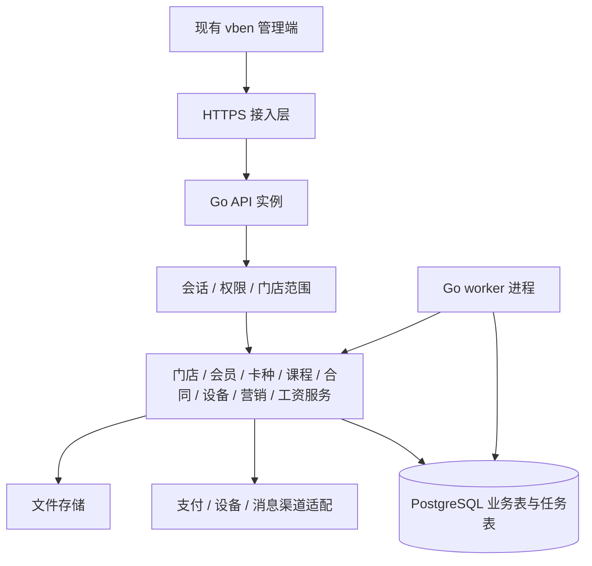

> ⚠️ **已失效（2026-09-29）**：后端选型已改为芋道 yudao（Spring Boot）。本文的 Go 选型、自研会话/权限/任务等设计**不再适用**，仅保留容量估算作为历史参考。现行技术路线见 `target/plan/03-architecture.md`。

# Go 后端设计与三万日活容量规划

更新：2026-09-08。用户已审阅原范围/数据库/API 方案，本文件补齐后端内部设计；按用户对 Go 的倾向调整选型。数据库及 HTTP 契约继续使用，只同步修正批量额度和长任务行为。本文是实施设计，不是已运行的服务或性能测试报告。

实施时间调整：本文件描述的 Go 后端属于第二阶段；第一阶段先完成全部管理端页面、现有 Nitro Mock 业务接口及 PostgreSQL 结构和初始数据。Go 选型不变，不能因此提前跳过第一阶段。

## 1. 日活与选型

日活三万人不等于三万人同时请求，也不直接推出必须使用 Go。决定容量的参数包括每人每天动态请求数、晚间高峰集中度、数据库每次查询耗时、批量任务、设备上报及媒体流量。当前缺少这些实测数据。

以下按“未来全端合计三万日活”举例，暂不把会员端流量当作第一版管理端真实流量。若三万专指网页管理员，仍需统计实际操作次数和高峰分布。

| 情景假设 | 动态请求/人/日 | 总动态请求/日 | 全天平均 RPS | 假设峰值倍数 | 估计峰值 RPS |
| -------- | -------------: | ------------: | -----------: | -----------: | -----------: |
| 使用较轻 |             50 |     1,500,000 |         17.4 |           10 |          174 |
| 中间情景 |            100 |     3,000,000 |         34.7 |           10 |          347 |
| 使用较重 |            200 |     6,000,000 |         69.4 |           20 |        1,389 |

公式：平均 RPS = 日活 × 每人动态请求数 ÷ 86,400；峰值倍数仅是情景假设，不是行业事实。静态资源、视频播放、设备后台上报不包含在上述请求数中，必须另算。

以设计场景 1,000 RPS、平均响应时间200ms估算，约200个请求同时在处理（到达率×平均耗时）。这不代表200条数据库连接，也不保证1,000 RPS已达标。数据库连接需求取决于每请求 SQL 数和每条 SQL 占用连接时间。例如2条查询、每条平均10ms，仅数据库平均占用约20条连接；长事务/慢查询会显著增加等待。

选用 **Go + 标准库 HTTP + PostgreSQL + pgxpool，按业务模块组织一个后端应用**。理由是统一后续服务器语言、明确控制并发与资源、独立部署；不能据此宣称同样 SQL 在 Go 中自动更快。原 NestJS 方案没有经测试被证明不够用，目前尚未实现后端，所以此次调整不涉及重写业务代码。

## 2. 组件和依赖

| 能力 | 选择 | 使用边界 |
| --- | --- | --- |
| HTTP/路由 | Go `net/http`、ServeMux | 标准库支持方法和路径参数路由，第一版无需额外框架 |
| 数据库 | `github.com/jackc/pgx/v5` + pgxpool | SQL、事务、连接池；每进程共享池，不在每请求新建连接池 |
| 账号安全 | `crypto/rand`、摘要标准库 + `golang.org/x/crypto/scrypt` | 随机会话、带独立盐的密码派生；不自创密码算法 |
| DTO/校验 | 请求结构体 + 显式 Validate 函数 | 公共校验仅抽取必需的日期、金额、分页、ID等；不创建反射式通用业务引擎 |
| 日志/配置 | `log/slog`、环境变量 | 结构化请求日志，不打印密钥、密码、人脸模板 |
| 后台任务 | Go worker + PostgreSQL 任务表 | 初期不引入 Redis、Kafka、RabbitMQ 等服务 |
| SQL迁移 | 第二阶段独立 migrate 命令、根目录 SQL 文件、schema_migrations | 读取第一阶段的 database/migrations，按序执行并加迁移互斥锁；部署时随服务提供同一份脚本，不在Go目录复制一套 |

直接依赖仅 pgx 和 x/crypto，传递依赖由 go.mod/go.sum 记录；前端依赖不变。这次只修改设计文档，没有安装 Go、依赖或基础设施。当前命令环境未找到 Go 可执行程序，实施时先确认工具链可用位置。

Go 路由能力见 [net/http 官方文档](https://pkg.go.dev/net/http#ServeMux)；连接池配置和统计能力见 [pgxpool 官方文档](https://pkg.go.dev/github.com/jackc/pgx/v5/pgxpool)。

## 3. 部署和内部结构



API 与 worker 使用同一套业务代码，两个进程入口，可以分别增加实例。模块按业务划分，不按每张表拆独立服务；不提前引入分布式事务或服务注册中心。

```text
database/
  migrations/001_...sql   # 第一阶段编写，第二阶段复用
  seeds/                 # 必需初始化与开发示例分开
apps/api/                # 第二阶段创建
  go.mod
  go.sum
  cmd/server/main.go
  cmd/worker/main.go
  cmd/migrate/main.go
  internal/
    app/                 # 显式组装路由、服务、连接池
    config/              # 环境变量及启动校验
    httpx/               # JSON、错误、请求ID、鉴权中间件
    database/            # 连接池及事务执行
    auth/                # 会话、员工授权、角色权限
    stores/
    employees/
    members/
    cards/
    courses/
    checkins/
    contracts/
    approvals/
    devices/
    sales/
    marketing/           # 券、额度、积分、礼品
    messages/
    content/             # 小程序展示、活动、加盟、反馈
    settlement/
    payroll/
    reports/
    files/
    jobs/                # 已注册任务领取与租约
```

模块内按需要放 `handler.go / service.go / repository.go / types.go`；小模块可合并文件。处理链为：handler解析/校验请求 → service检查业务状态与门店范围、发起事务 → repository执行限定SQL → handler返回统一响应。

只有实际需要替换或隔离的数据库/外部渠道边界定义接口，不为每个结构体创建接口。事务由 service 控制，repository不能各自偷偷提交。跨模块动作显式调用业务服务，不靠 HTTP 绕回同进程。

## 4. 认证、权限与请求执行

1. 沿用 `/api/auth/login` 等已设计路径及 code/data 响应；前端路由和 Pinia 登录流程继续使用。
2. 登录生成随机 access/refresh token，数据库保存摘要、到期时间、撤销状态。每次请求检查当前账号、会话及授权；停用/改权不能依赖旧 token 中永久保存的权限。
3. 后端构造不可由请求 body 覆盖的 Scope（总部或授权门店集合）。所有业务查询、计数、附件、批量目标、报表传入 Scope。
4. 门店成员详情只返回允许的共用身份字段及该店业务数据；同一会员在其他店的订单、合同、体测仍受隔离。
5. JSON限制大小并拒绝未知字段/多余 JSON 值；查询/body/path 都校验。标准错误转换为400/403/404/409等，不把内部SQL/堆栈传前端。
6. 使用 request context 取消数据库和渠道请求。普通API默认总预算5s、交互SQL初始2s超时、锁等待初始1s，均为可调整起点；报表单独预算，大任务后台处理。上传使用独立大小/时长限制，不沿用普通JSON限制。
7. 金额在HTTP为十进制字符串，Go业务中按最小货币单位整数计算；比例按固定精度整数计算，乘除校验溢出并规定舍入，落库仍为numeric。不会把金额转 float64。
8. 登录限流结合账号失败计数与单实例并发限制；多实例共享账号失败状态。需要跨实例IP限流时优先使用已部署接入层能力，到部署时再确定，不引入新的限流服务。

## 5. 优惠券额度与一键维护

用户确认额度单位为张数。“全部适用门店各100张”按每家100张追加，不理解为全部门店共享100张，也不理解为100元优惠预算。

| 动作                      | 操作者                       | 写入与结果                                       |
| ------------------------- | ---------------------------- | ------------------------------------------------ |
| 选定/全部适用门店追加额度 | 总部 coupons:allocate        | 创建额度批次与固定门店集合；增加门店可发张数     |
| 向会员发券                | 总部或授权门店 coupons:issue | 指定发行门店，预占额度；成功创建会员券并消耗额度 |
| 查看额度/流水             | 总部或授权门店 coupons:read  | 可分辨已分配、待发预占、已发、可用               |
| 其他一键批量管理          | 对应业务权限                 | 使用已定义发券/消息等批次，不开放任意数据库更新  |

门店可用额度 = 累计分配张数 − 已发张数 − 待发预占张数。总部代店发券同样扣该店额度。券核销不再次扣额度；券过期不自动恢复历史发放额度。

额度分配过程：验证券模板/适用门店/总部权限 → 固定当时目标门店集合 → 计算总张数并锁模板预留 → 同事务写批次、逐店项及后台任务 → 返回202 → worker按项追加门店额度和流水。配额总量不足时整体拒绝；已建任务遇到门店停用等执行期变化时，该项失败并释放预留，其他项可成功。

发券过程：校验每个会员及发行门店 → 按门店汇总需要张数 → 按固定顺序锁额度并预占 → 写批次与任务 → worker逐会员校验个人上限、有效期、当前权限/状态 → 在一个事务中写券、扣预占、增已发计数、写额度流水和明细结果。失败项释放预占；任务最终失败也必须结清未执行项，不能永久占住额度。

一键操作只提交一次HTTP请求，页面查询任务进度。显式传来的越权门店令整个请求失败；权限范围不能静默扩大。“全部”只指提交时符合条件的集合，后续新开的店不会偷偷加入旧任务。

## 6. 长任务、重试与多实例

- 批次与 background_jobs 在同一事务提交，避免“业务记录存在但任务没发出去”。任务类型白名单对应具体服务，不执行数据库中任意代码/SQL。
- worker用短事务 `FOR UPDATE SKIP LOCKED` 领取可执行任务，写 lease_owner/lease_token/lease_until 后提交；外部网络等待不占数据库事务。
- 初始 worker 并发4、每轮取任务上限20、逐批处理50..100个目标，均可按测量调整。不能按每个会员/每家店无限启动 goroutine。
- 租约续期/完成只允许当前 token；处理数据库业务的最终事务同时验证租约和业务唯一键。实例重启后未完成任务可接管，同一目标最多生效一次。
- 幂等键由操作者+操作类型+客户端键确定；批次保存规范化请求摘要，重复键不同正文409；内部每项另有唯一来源键。每次重试不重新创建批次或预占。
- 可重试的临时错误采用带随机扰动的退避，设次数/总时限。参数、越权、额度不足不反复重试。全批次完成、部分失败、全部失败分别展示。
- 对外发送无法仅靠本地事务保证“恰好一次”。使用渠道幂等键或按外部流水查询；开门等无法确定已执行的操作进入unknown/timeout，记录结果并要求状态核实，不自动再开一次。
- 工资计算也走任务；同店同月同一时刻只能一个计算任务。按员工计算并保存规则/来源快照，未全部成功不能确认整月工资；已确认工资不能重算覆盖。
- 同一业务资源需要再次执行（如重算未确认工资）时，在事务中将其已结束的唯一任务重新置queued、重置尝试计数并清除租约；进行中的任务返回409。旧 worker 不能使用已失效租约写入新一轮结果。

PostgreSQL 官方明确 `SKIP LOCKED` 可用于多个消费者访问队列表，但不适合需要一致视图的普通查询。因此它只用于领取任务，不用于忽略额度/库存锁竞争。见 [PostgreSQL SELECT 文档](https://www.postgresql.org/docs/current/sql-select.html)。

## 7. 数据库访问与汇总

- API每进程初始连接池上限20，worker每进程上限10；这是起点，不是越多越好。连接池最大值显式配置，观察获取连接等待及SQL耗时后再调整。[pgxpool 提供 MaxConns 与池统计](https://pkg.go.dev/github.com/jackc/pgx/v5/pgxpool#Config)。
- 若2个API实例+1个worker：业务最大连接=2×20+10=50。数据库若配置max_connections=100，其余用于迁移/管理/其他服务和余量；后续扩API实例前重算总预算，不能每个实例都按100开池。
- 所有列表有分页及门店/日期索引；大流水列表后续可增加游标分页，初版保留vben分页协议。禁止每行再单独查卡、员工、合同造成N+1查询。
- 报表在SQL端按时间与门店聚合，不把全库明细载入Go。跨长周期报表若实测慢，再增加按日业务汇总表；首版不预先铺开缓存/分区/读写分离。
- 资金、权益、积分和额度以数据库约束、行锁、唯一键保证正确；默认使用短事务和显式锁，不能靠内存锁跨实例保护数据库余额。
- 时间排序流水可能增长很快。例如未来实际每天10万条设备事件，一年约3650万条；这是示例，不是已知业务量。达到该量级再按真实查询/保留需求制定时间分区，第一版不实现设备上报接口。
- 体测/训练等长期档案不因优化查询而删除；大文件不入PostgreSQL。

## 8. 初始部署参考与扩容条件

以下仅用于选择第一次容量验证的起点，不是已验证规格、采购建议或三万日活保证。云CPU性能、磁盘延迟、数据规模都会影响结果。

| 部分 | 初始参考 | 目的与边界 |
| --- | --- | --- |
| Go API | 先1个实例；准备扩到2个，每个4 vCPU/8GB作为验证起点 | 多实例不保存本地权威会话/任务；增加实例须检查数据库连接预算 |
| worker | 独立进程，初期可与API同机但限制并发 | CPU/内存/磁盘竞争明显时再移独立机器 |
| PostgreSQL | 独立实例，8 vCPU/16GB及SSD作为验证起点 | 慢SQL、锁竞争和磁盘往往比语言先限制容量；容量按实际记录/索引测算 |
| 文件 | 开发本地持久目录；多实例部署必须有共同文件存储 | 对象存储/现有共享盘选型在部署时确定；不自动订购服务 |
| HTTPS接入 | 复用部署环境已有负载均衡/反向代理 | 当前不安装新网关工具；生产入口须支持TLS |

单API+单数据库不宣称高可用，2个API也不能消除数据库单点；如果用户另有不停机/故障恢复指标，届时补充数据库高可用部署需求。

普通环境图片/视频应通过文件存储/静态内容路径交付，不经业务SQL；未来监控直播不由Go管理API中转。假设100人各看2Mbps视频，出口约200Mbps，和管理接口RPS是不同容量维度。

扩容按证据执行：API CPU持续高且DB轻闲可增API；连接池等待高先查慢SQL/连接占用，再决定池大小；数据库锁等待高先缩短事务/消除热点；任务排队长且DB有余量再增worker。没有测量前不引入Redis、微服务或分库分表。

## 9. 与本项目相称的容量验证

第一阶段不以 Mock 测试代替性能验证。第二阶段实现真实业务后，除接口联调外，为回答用户的容量问题做一次必要的真实数据库负载验证，不增加额外验收矩阵或发布流程，也不安装压测框架。

使用Go标准工具编写有限时长/并发的请求驱动，覆盖登录后会员列表/详情、分页签到、门店统计、并行批量发券；普通列表和写操作分别观察。金额/权限/重复发券正确性优先，不能只压返回固定JSON的空接口。

以代表性历史数据执行，从低负载逐步接近上述347 RPS中间情景，再探索更高负载。记录实际吞吐、P95延迟、错误率、连接等待、DB CPU/慢SQL、任务完成时间。普通列表P95<300ms可作为初始工程目标，是否达标必须报告实测及硬件/数据量；工资、全局报表、上传分别设目标，不混入普通列表延迟。

## 10. 实施顺序

遵循用户最新指定的两个阶段：

1. **前端 + Mock 后端 + 数据库**：在 `apps/web-antd`、`apps/backend-mock`、`database` 中按模块完成管理页面、模拟接口、实际 SQL 结构与初始数据。先基础资料，再业务模块；全部第一版管理端模块及全量需求表结构完成后进入第二阶段。
2. **Go 后端**：实现 `apps/api` 入口/配置/错误处理、会话/授权、连接池和迁移命令，复用第一阶段 SQL，按模块实现真实服务、事务与任务，再把同一前端接到 Go 完成持久化联调。

第一阶段暂不实现 Go 服务或提前安装其依赖。模拟接口与 Go 使用相同契约，模拟状态不作为生产数据自动迁移；正式权限等初始化使用版本化初始数据。数据库预留实体在两个阶段都没有其他端路由。

本轮只补后端设计和业务语义；不把文档改动描述为后端、真实设备或三万日活能力已经完成。
