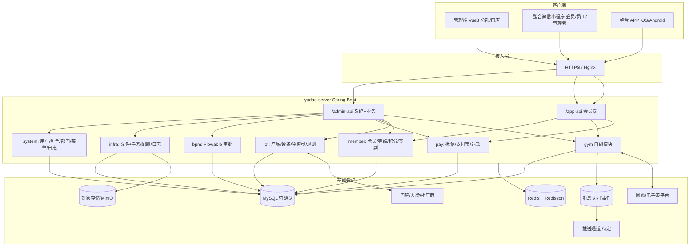

# 03 · yudao 全栈技术路线

> 目标：用芋道 yudao 作为底座，自有 `gym` 模块承载健身房业务，覆盖管理端、整合小程序、整合 APP、IoT、支付与通知。
> 未定项以 `05-decisions.md` 编号引用。

## 1. 总体架构

单一后端应用（yudao-server 多模块），不引入微服务；以模块边界 + 接口隔离，符合合同第 6 条的第三方风险隔离要求。

## 2. yudao 模块选型

| 模块 | 用途 | 对应合同 |
| --- | --- | --- |
| `yudao-module-system` | 用户、角色、菜单/权限、部门、岗位、租户、字典、站内信、短信、操作日志、登录日志 | R31、R42，以及全部员工的账号与权限 |
| `yudao-module-infra` | 文件存储、定时任务、代码生成、配置、API 日志、WebSocket | R42、文件与通知底座 |
| `yudao-module-member` | C 端会员（账号、等级、积分、签到、标签、分组） | R04、R12、R13、R39 |
| `yudao-module-bpm` | Flowable 工作流：审批模板、实例、任务、表单权限、会签/或签 | R09、R21、R25、R26、R31 |
| `yudao-module-pay` | 支付应用、渠道（微信/支付宝）、订单、退款、回调、转账 | R06、R07、R41 |
| `yudao-module-iot` | IoT 产品/设备/物模型/协议接入/规则引擎 | R02、R27、R37（设备接入底座） |
| **自研 `yudao-module-gym`** | 门店、员工扩展、会员卡、通卡、课程/预约/签课、体测档案、合同、工资、售卡/核销设置、报表、设备业务层、通知接收人 | R01–R43 中的业务主体 |

**不采用**：mall（电商）、erp/wms/crm/mes/hrm/fms/pms/oa/ai/im 等与健身房无关模块。`member` 的商城交易能力不启用，交易走 `gym` + `pay`。

> 模块清单与版本以最终选定的 yudao 版本为准；引入前逐个核对是否与 R 范围相关，避免“为了用而用”造成维护面膨胀。

## 3. 账号体系（游客 → 会员 → 员工 → 管理者 → 总部）

### 3.1 两类身份

| 身份域 | 表/模块 | 登录端点 | 适用范围 |
| --- | --- | --- | --- |
| C 端 | `member_user`（yudao-member） | `/app-api/member/auth/*` | 小程序、APP 会员侧 |
| B 端 | `system_users`（yudao-system） | `/admin-api/system/auth/*` | 管理端、员工/管理者工作台 |

### 3.2 角色层级

| 角色 | 归属 | 数据范围 |
| --- | --- | --- |
| 游客 | 无账号（未登录） | 门店公开信息 |
| 潜客 / 会员 | `member_user`（留手机号登录即建记录；持卡为会员，未成交为潜客） | 仅本人数据 |
| 员工 | `system_users` + 主门店 `dept_id` + 岗位 + 角色 | 本人负责会员 |
| 管理者（店长/负责人） | `system_users` + 门店角色 | 本门店 |
| 总部 | `system_users` + 总部角色（data_scope=全部） | 全部门店 |

### 3.3 整合客户端的身份与登录（R40 关键）

同一 APP/小程序承载三种角色，采用**双身份协商**：

1. 默认走 member 登录，进入会员功能。
2. 若手机号命中 `system_users`（员工/管理者），客户端提供“进入工作台”入口：以 B 端账号（或手机号+验证码换取 B 端 token）登录，APP 同时持有 member 与 system 两个 token。
3. 底部导航按 B 端角色权限显示“工作台/管理”板块；服务端对每个工作台接口按 B 端权限 + 门店数据范围鉴权（R40“角色切换不扩大数据权限”）。
4. 员工与会员若为同一自然人，不做账号合并，仅以手机号建立弱关联，避免越权。

> 备选：自定义统一网关签发单一 token（内含用户类型与角色）。若双 token 带来的复杂度可控，优先双 token，复用 yudao 原生认证。

## 4. 门店与数据权限

- **门店 = `system_dept` 树**：总部为根节点，门店为子节点；门店内部可再分层（如有）。
- 总部角色 `data_scope = 全部`；门店角色 `data_scope = 本部门及子部门`（或按 yudao 的“自定义部门”配置）。
- **多店任职**：`system_users.dept_id` 只表达主门店；如需一人多店，新增 `gym_employee_store` 关联表并扩展数据范围。
- **负责会员**：`gym_member_coach`（负责教练）、`gym_member_store`（会员归属门店）——决定 R01 通知范围、R18/R20 可见范围、R23/R24 业绩与会员统计口径。
- **实现要点**：yudao 的 `@DataPermission` 默认作用于系统模块；自研 `gym` 的 Mapper 需显式配置数据权限规则，或统一走自定义 `GymScope`（服务端构造，禁止请求体覆盖，对应旧设计第 4.3 条的风险点）。

## 5. 权限码与菜单

- 统一权限码规范：`gym:<资源>:<动作>`，例如 `gym:member:query`、`gym:card:create`、`gym:approval:decide`、`gym:device:command`。
- 管理端菜单/按钮权限由 yudao 菜单管理下发（`accessMode=backend`）。
- 员工/管理者移动端接口用同一套 B 端权限码在服务端校验；C 端接口不依赖 RBAC，按会员本人与门店归属鉴权。
- 维护一份 `gym` 权限码清单（代码内常量 + 菜单初始化 SQL），作为 R42“权限控制”验收证据。

## 6. 移动端（uni-app 一套代码）

- 技术栈：uni-app（Vue3 + TypeScript），一套代码发布微信小程序 + iOS/Android APP（+ 可选 H5）。
- **登录与角色**：见 3.3；tabbar 与分包按身份动态生成（会员 / 员工 / 管理者 / 总部汇总）。
- **推送（R43）**：小程序用**订阅消息**；APP 用**原生推送**（uni-push / 个推 / 极光，待定 D/R-04），需要打包证书与厂商配置。消息中心兜底查询（R43 要求“模拟系统不投递时仍可在有权消息中心查询”）。
- **权限适配**：授权说明、状态提示、设置引导、前后台接收、点击跳转、撤回/退出/换设备的绑定处理、锁屏脱敏（R43）。
- 基础底座优先选择轻量的 yudao uni-app 模板，**不直接复用商城（mall uniapp）**的重交易结构。

## 7. IoT（门禁 / 人脸 / 智能柜）

- **底座**：`yudao-module-iot` 管理产品、设备、物模型、协议（HTTP/MQTT/TCP 等）与规则引擎。
- **入站事件**：门禁/人脸/柜设备 → 厂商回调/MQTT → 适配层统一为 `gym_access_event`（人员、设备、时间、结果）→ 关联会员 → 触发准入策略与通知（R01/R02/R10）。
- **出站指令**：远程开门/开柜（R27）经适配层调用厂商 API；结果分 `success/queued/timeout/unknown/failed`，`unknown` 不得自动重开（沿用旧设计第 6 节“不能仅靠本地事务保证恰好一次”的原则）。
- **人脸合规（附件三）**：软件不保存原始人脸图片；特征优先设备内比对，仅回传必要结果；确需传输/云端存储须在上线前确认合法依据与单独同意；特征保存 ≤ 30 日或会员退出即删。
- **替代方式**：必须同时提供扫码/前台人工核验（R02、附件三）。
- **风险**：厂商/协议/SDK 未定（R-01），先做适配接口抽象与模拟设备，实物联调待资料到位。

## 8. 支付、连续包月、团购核销、分账

| 能力 | 方案 | 关键约束 |
| --- | --- | --- |
| 在线购卡/私教（R07/R41） | `gym` 下单 → `yudao-pay` 微信/支付宝下单 → 回调幂等 → 开卡/权益 | 回调验签、重复通知、失败不误开卡 |
| 连续包月（R06） | 微信委托代扣（签约/解约/扣款计划）+ `yudao-pay` | 依赖甲方微信支付产品与资质；不提供资金池 |
| 分账/到账周期（R35） | 微信服务商/直连分账能力 + `gym` 分账规则与结算记录 | 以实际可开通能力为准；`yudao-pay` transfer 可部分复用 |
| 团购核销（R05） | 美团/抖音/大众点评开放平台 API + `gym_verification` | 有效/无效/重复/超时均正确返回并留痕；平台接口变更免责 |
| 收款账户（R35） | 账户配置 + 渠道绑定入口 | 未绑定渠道时明确返回“未配置”，禁止假成功 |

金额一律以最小货币单位整数计算并落 `numeric`/`decimal`，禁止 float（沿用旧设计第 4.7 条）。

## 9. 审批（yudao BPM）

- R31 审批模板 = BPM 流程模型（仿钉钉/飞书 SIMPLE 设计器 + BPMN）；R09/R21/R25/R26 的改价、开卡、工资确认等 = 流程实例/待办任务。
- 移动端工作台接 BPM 待办/已办 API，并接入 R43 通知（待办与结果）。
- 审批权限、门店范围、负责会员由服务端校验，不信任客户端。

## 10. 通知体系（R01 / R43）

- 通道：站内信（system notice）+ WebSocket 实时（infra）+ APP 原生推送 + 微信小程序订阅消息 + 短信（登录验证码/提醒）。
- **接收人解析**：按门店、负责教练、审批权限计算（R01：店长收全部、私教仅本人负责会员、陌生/潜客仅推店长）。
- 统一抽象 `gym_notification`（模板 + 事件 + 接收人 + 通道 + 状态），支持“投递失败但仍可在消息中心查询”。
- 锁屏不展示会员敏感信息；撤回/退出/换设备按 R43 处理。

## 11. 文件与数据安全（附件三 / 合同第十条）

- 文件走 `yudao-module-infra` 文件服务（本地/MinIO/OSS，部署时确定）；合同等私有文件**鉴权下载**，不暴露公开静态 URL。
- 人脸特征尽量不落库或 ≤30 日；体测/训练档案按医疗健康属性严格保护；访问留痕、权限分级、HTTPS、敏感字段加密。
- 数据仅在境内；开发测试使用脱敏/模拟数据；仓库不提交真实会员数据与密钥。
- 返还与删除：处理终止后按可机读格式返还，15 日内删除副本并留记录。

## 12. 与现有前端原型资产的关系（见 D-01）

| 方案 | 说明 | 代价 |
| --- | --- | --- |
| A. 采用 `yudao-ui-admin-vben`（vben/AntD） | 与现工程同属 vben/AntD，免费获得 yudao 系统/BPM/支付/会员/IoT 页面；迁移现有 gym 页面 | 需对齐 yudao 管理端框架版本与目录约定 |
| B. 保留现 `apps/web-antd` + 适配层 | 复用现有 60+ 页面与 `feat/yudao-api-adapter`；但需自研 yudao 各模块页面与接口 | 管理端工作量最大 |
| C. 采用 `yudao-ui-admin-vue3`（Element Plus） | yudao 模块页面最全、社区主流；健身房页面需从 AntD 迁移到 Element Plus 或代码生成重建 | 前端重写量大，但长期最贴合 yudao |

无论哪种方案，**业务规则以 `gym` 模块为准，页面仅承载交互**；现有 Nitro Mock 仅作界面联调参考，不参与交付。

## 13. 部署与运行环境

- 组件：MySQL（待确认）+ Redis（Redisson）+ yudao-server + Nginx（管理端静态 + API 反向代理 + HTTPS）+ 对象存储 + 推送/支付/设备渠道。
- 环境：开发 / 测试验收 / 生产；密钥走环境变量或配置中心，不入库不入仓。
- 提审上架、生产部署、试运行属付清全款后的支持期服务（合同第 9 条），不阻塞里程碑 B/C 付款。
